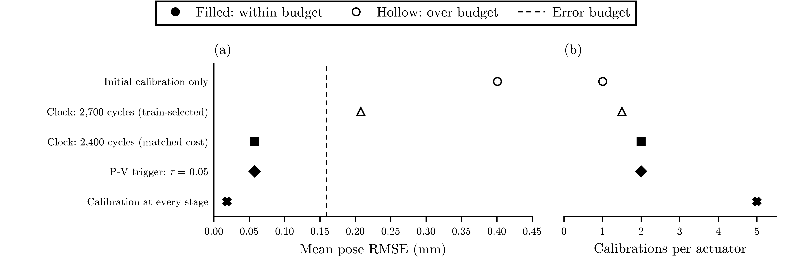
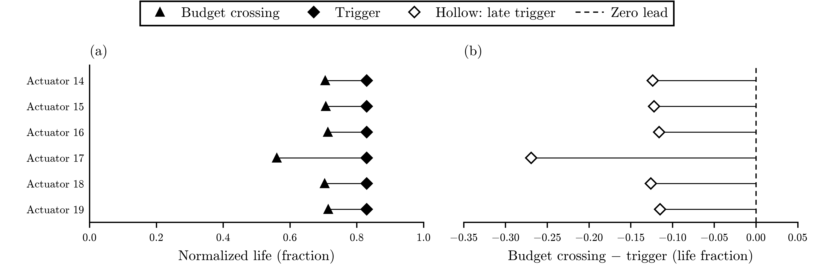
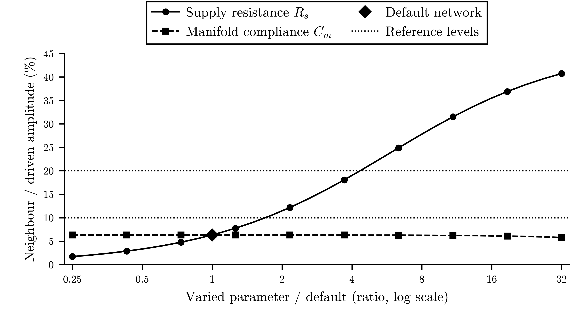

# Results

The simulation study is closed. The [matched-cost audit](../data/sim/phaseD/matched_clock_audit.json)
shows that a cycle-count schedule ties the pressure–volume (P-V) trigger at the
same recalibration count. That result led to the
[v1.4 withdrawal](corrections/v1.4-withdrawn-2026-10-02.md). Maintenance theory
predicts the tie for units that share one degradation curve
([why the tie was expected](corrections/v1.4-withdrawn-2026-10-02.md#why-the-tie-was-expected-2026-10-09)). The original results
below remain unchanged and synthetic. Archived v1.3 retains its
[methods correction](corrections/v1.3-methods-2026-09-05.md); the
[withdrawn candidate](preprint_v1_4_candidate.md) is kept as a record.

The [successor preparation record](decisions/0002-successor-software-preparation.md)
locates separate local metrology calculations and a theoretical figure. They
contain no actuator measurements. The [history index](history/README.md) links
earlier proposals and figures. The unrun C2 implementation was removed; all
executed results remain. The [roadmap](../ROADMAP.md) lists the successor's
prerequisites and pending decisions.

## Study 1: health-indicator validation

The study compares proposed fatigue indicators with the simulator's known
fatigue state. It tests recovery, the onset of faster degradation, measurement
noise and actuators held out from fitting. Its figures are under
`data/sim/study1/`.

## Study 2: pressure-only proprioception drift

Pose-estimation error grows when a calibration made on a young simulated
actuator is used throughout its life. The study compares fixed and dynamic
corrections with either a shared air supply or separate supplies.

## Study 3: recalibration policy

<!-- policy-summary:start -->
| Policy | Mean pose error, RMSE (mm) | Calibrations per actuator |
|:---|---:|---:|
| Initial calibration only | 0.401 | 1.0 |
| Clock: 2,700 cycles (train-selected) | 0.208 | 1.5 |
| Clock: 2,400 cycles (matched cost) | 0.058 | 2.0 |
| P-V trigger: τ = 0.05 | 0.058 | 2.0 |
| Calibration at every stage | 0.019 | 5.0 |
<!-- policy-summary:end -->

Saved simulation point summaries for 6 held-out actuators; no uncertainty bars.
Panel (a) shows mean pose RMSE [mm] and panel (b) calibrations per actuator for
five policies, marked by shape: initial calibration only (circle), the
train-selected clock at 2,700 cycles (triangle), the matched-cost clock at
2,400 cycles (square), the P-V trigger at τ = 0.05 (diamond), calibration at every
stage (cross). Left is better in both panels. The dashed line in (a) is the
train-derived error budget, 0.159 mm. A filled marker means the policy is within
the budget; a hollow marker means it exceeds it: initial calibration only and
the train-selected clock at 2,700 cycles. At matched cost the clock ties the P-V
trigger: both reach 0.058 mm with 2.0 calibrations per actuator. Counts include
the initial calibration; error averages life stages, then actuators. Values: the
policy table and policy_comparison.csv. Sources: matched_clock_audit.json and
study3_results.json; no physical measurements.

[Caption file](../data/sim/summary/policy_comparison.caption.md) · [matched-cost audit](../data/sim/phaseD/matched_clock_audit.json) ·
[Study 3](../data/sim/phaseD/study3_results.json) · [download full-precision table](../data/sim/summary/policy_comparison.csv).

Pooled P-V association: `r = 0.885`, actuator-cluster bootstrap `[0.853, 0.950]`;
leave-one-actuator-out `[0.576, 0.973]`. The point-level interval `[0.835, 0.958]`
is superseded. [Cluster source](../data/sim/phaseD/study3_cluster_ci_results.json).

Actuator-cluster resampling and leave-one-actuator-out sensitivity are already
reported in the committed outputs; point-level inference is superseded.

Study 3's health signal is a separate analytic SLS probe with zero rest input,
not the noisy Phase D volume channel. Noise, quantization and variable-rest
robustness of that signal have not been demonstrated. Shared latent fatigue
drives both endpoints, so correlation is structurally favored. The 2026-10-02 audit found it is stronger than
favored: normalized loop area equals the normalized compliance multiplier to
within 2.3 × 10⁻¹⁴ and is the same curve for every actuator.

The policy error averages pose RMSE across five sampled life stages and then
across actuators. Passing the average-error budget does not guarantee an error
limit at every moment. The 60% reduction in calibration events includes the
initial calibration; probe time and recalibration downtime were not measured.

Saved Study 3 crossing estimates for the 6 held-out actuators at the deployed
threshold τ = 0.05; 0 excluded. Panel (a) shows, per actuator, the normalized
life at which pose error crosses the error budget (triangle) and at which the
P-V trigger fires (diamond); the thin line joins each pair and is not an
interval. Panel (b) shows the lead, budget-crossing life minus trigger life,
with the dashed line at zero lead; a hollow diamond marks a late trigger
(negative lead). The trigger fires after the budget crossing on every held-out
actuator, with leads from -0.269 to -0.115 life. Crossings are interpolated from
the saved life-stage analysis, with no new trajectories or exclusions. Values:
trigger_timing.csv. Source: study3_results.json.

[Caption file](../data/sim/summary/trigger_timing.caption.md) · [Download records](../data/sim/summary/trigger_timing.csv) · [Source](../data/sim/phaseD/study3_results.json).

The manuscript [association figure](../data/sim/phaseD/study3_fig3_leading_indicator.png)
and [unmatched-clock policy plot](../data/sim/phaseD/study3_fig4_recal_tradeoff.png)
are redrawn from the saved Study 3 result. The association curve is generated by
the shared fatigue law; the policy plot omits the matched-cost clock.
Neither supports a physical precursor claim.

## Study 4: shared-manifold sensitivity

Within the tested network settings, pressure changes in one chamber produce a
smaller response in its neighbours. That cross-talk grows as the simulated
supply resistance rises. The result depends on the network model and is not a
measurement of a physical gripper.

Saved deterministic Study 4 sweep of the lumped three-chamber network at a 2 Hz
probe. Cross-talk is the neighbour pressure amplitude divided by the driven
amplitude. One parameter is varied at a time, as a ratio to its default on a
logarithmic axis, with all others fixed. Solid line and circles: supply
resistance R_s; dashed line and squares: manifold compliance C_m. The filled
diamond is the default network, 6.3%. Dotted lines are the original sweep
reference levels, 10% and 20%; they are not confidence limits. Cross-talk rises
with supply resistance, reaching 10% at 1.7 times the default and 20% at 4.3
times the default, and stays between 5.8% and 6.3% across the compliance sweep.
No uncertainty band; no physical gripper tested. Values: cross_talk.csv. Source:
study4_results.json.

[Caption file](../data/sim/summary/cross_talk.caption.md) · [Download ratios](../data/sim/summary/cross_talk.csv) · [Source](../data/sim/phaseD/study4_results.json).
The [manuscript figure](../data/sim/phaseD/study4_fig_crosstalk_sensitivity.png)
shows the same sweep.

## Result sources

- Study JSON and figures: `data/sim/`
- Frozen claim ledger: [`result_spine.md`](result_spine.md)
- Figure-generation lineage: [`data-and-figures.md`](data-and-figures.md)
- Manuscript-number checks: `scripts/check_manuscript_numbers.py`

## Observability program — Studies A and B (2026-09-16, synthetic, preregistered)

[Program](specs/observability-program/program.md) · [evidence](../evidence/observability-2026-09-16/README.md).
The question is whether pressure measurements distinguish an actuator's
simulated fatigue state across units with different degradation paths.
*Identifiability* means that different model states can be distinguished from
the available measurements.

- **Study A:** In 30 simulated units, the normalized P-V loop-area indicator
  varied between units by 5–17 times its measurement noise from mid-life
  (ICC 0.98). Variation in the degradation law caused this spread; the modeled
  plant differences canceled when each unit was normalized to its young state.
  Trigger life at τ = 0.05 varied by only 0.044 life, so Study A failed its
  original timing rule (**A-FAIL**). A later owner amendment removed that rule
  before Study C ran.
- **Study B:** Five pressure-only features and a modeled young baseline could
  distinguish the life coordinate before degradation accelerated. The local
  Cramér–Rao calculation gave σ_u ≈ 0.02–0.03 life, depending on signal noise
  and amplitude. The original rule returned **B-PASS**. After onset, life,
  onset timing and leakage become difficult to separate. Brun's collinearity
  index for the three parameters together was 1.25e6, versus 60.8 and 5.83
  for the parameter pairs. This is a joint dependency that pairwise checks
  miss.

  A corrected profile-likelihood analysis found that the post-onset life
  coordinate is distinguishable in principle under the young-baseline-plus-
  aged-snapshot design, but poorly localized. One noise realization supported
  a broad region of roughly [0.75, 0.98]; the likelihood varied by 6e-10 over
  most of it. Both apparent endpoints touched bounds on other fitted
  parameters, and widening those bounds within a physically plausible range
  removed the upper endpoint. Thus no post-onset resolution figure is
  supported. The earlier ±0.05 claim came from a grid edge; the interim ±0.21
  claim came from a plateau ending at a parameter bound. Both are withdrawn.
  The fitted minimum was 0.775 for a truth of
  0.90 in that realization; this is an observed error, not an estimated bias.
  One aged snapshot without a modeled young baseline locates life even less
  precisely. [Correction evidence](../evidence/studyB-structural-correction-2026-09-25/README.md).
- **Study C:** One estimator combined baseline-normalized pressure features
  with cycle count and was tested on 10 held-out units after the Study A
  amendment. Its mean held-out life-coordinate RMSE was 0.093, versus 0.123
  for the clock alone. Only 6 of 10 units met the 0.10 error target, and only
  7 of 10 beat the clock, so the registered verdict is **C-FAIL**. Pressure
  helped mainly on short-lived units, where the clock's assumed rupture life
  was wrong. A further audit tested rupture-life coefficients of variation
  (CV) of 0.05 and 0.15 alongside the original 0.30. At CV 0.05, all 10 units
  met the error target but only 2
  beat the clock. At CV 0.30, 7 beat the clock but only 6 met the target.
  **C-FAIL** held across the tested levels for different reasons. There is no
  cross-unit transfer claim. [Dispersion audit](../evidence/dispersion-audit-2026-09-23/README.md).

These findings use one synthetic generator, assumed unit variation and local
parameter bounds. They do not establish performance on physical actuators.
